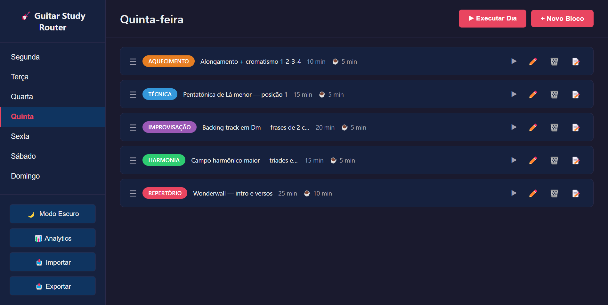
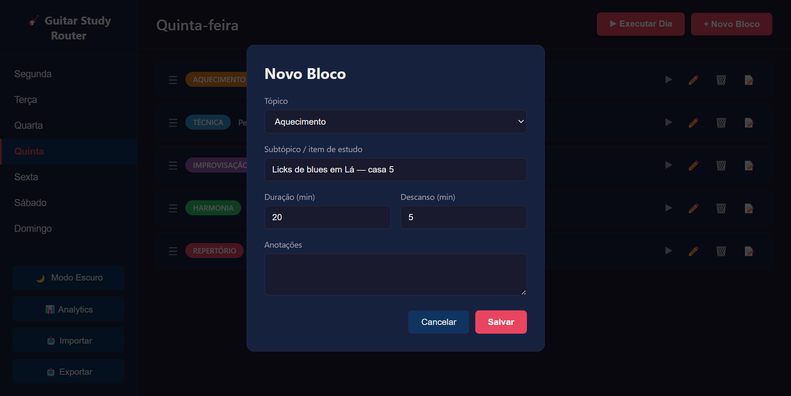
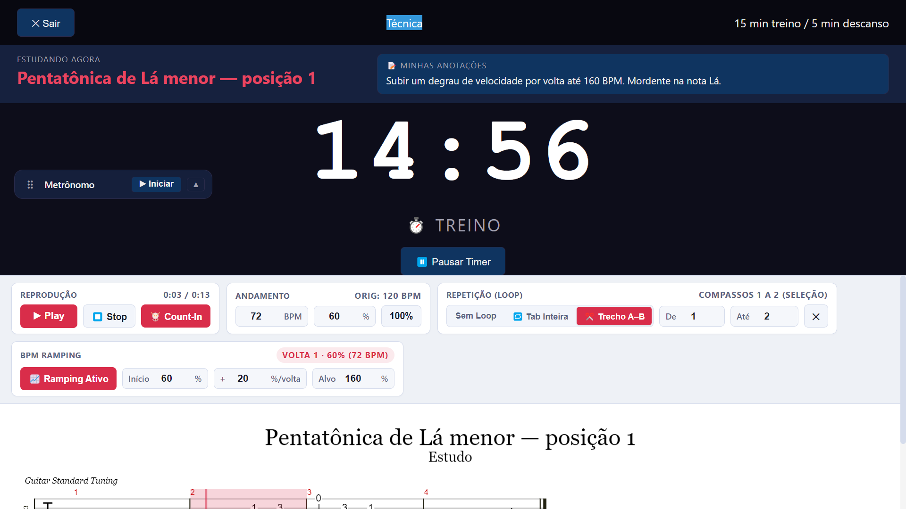
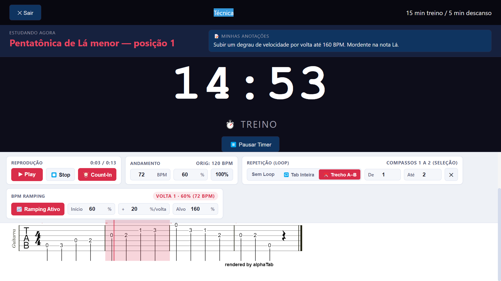
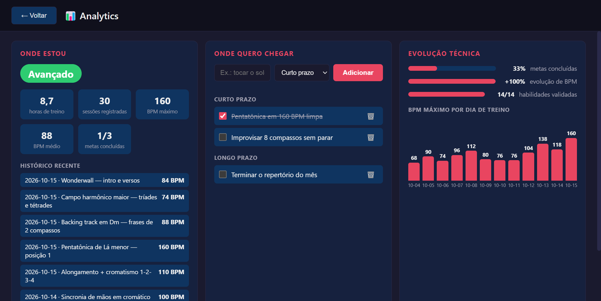

# 🎸 Guitar Routine

Aplicativo **desktop** (Electron) para organizar e **executar** rotinas de estudo de guitarra:
cronograma semanal, Modo Foco com cronômetro e metrônomo, player de tablatura com
**loop automático + ramping de velocidade**, player de áudio de referência com transposição,
fechamento de treino com métricas e um painel de **Analytics**.

> Feito para quem estuda sozinho e quer saber *o que* praticar, *quanto tempo* e *em que velocidade*.

---

## 📑 Índice

- [Visão geral](#-visão-geral)
- [Telas](#-telas)
- [Funcionalidades](#-funcionalidades)
- [Tecnologias](#-tecnologias)
- [Requisitos](#-requisitos)
- [Como rodar em desenvolvimento](#-como-rodar-em-desenvolvimento)
- [Como gerar os pacotes (Windows e Linux)](#-como-gerar-os-pacotes-windows-e-linux)
- [Estrutura do projeto](#-estrutura-do-projeto)
- [Onde ficam os dados](#-onde-ficam-os-dados)
- [Fluxo rápido de uso](#-fluxo-rápido-de-uso)
- [Limites e observações](#-limites-e-observações)
- [Licença e créditos](#-licença-e-créditos)

---

## 🔎 Visão geral

O app tem duas telas principais:

| Tela | Para quê |
| --- | --- |
| **Agenda (Schedule View)** | Montar o cronograma da semana: 7 dias, cada um com uma fila de blocos de estudo. |
| **Modo Foco (Focus View)** | Executar um bloco (ou o dia inteiro): cronômetro, metrônomo, tablatura, áudio e fechamento do treino. |

Cada **bloco** representa um item de estudo e tem: tópico, subtópico (texto livre),
duração, tempo de descanso, anotações, tablatura opcional (Guitar Pro), áudio de referência
opcional e um histórico de métricas (BPM alcançado por dia).

---

## 📸 Telas

### Agenda


### Novo bloco — subtópico em texto livre


### Modo Foco — cronômetro, metrônomo e controles do player


### Tablatura — cursor de acompanhamento e trecho A–B


### Analytics — nível, horas, habilidades e metas


---

## ✨ Funcionalidades

### 📅 Cronograma semanal
- Sete dias (Segunda → Domingo), com o dia atual selecionado automaticamente.
- Criar / editar / excluir blocos em um modal (tópico, **subtópico em texto livre**, duração,
  descanso, anotações, tablatura, áudio).
- **Arrastar e soltar** para reordenar os blocos do dia.
- Tópicos: `Aquecimento`, `Técnica`, `Improvisação`, `Harmonia`, `Repertório`.
  Tablatura e áudio ficam disponíveis para **Técnica** e **Repertório**.
- **Importar / Exportar** o cronograma completo em JSON.

### 🎯 Modo Foco
- Botão **▶ Iniciar** no bloco ou **▶ Executar Dia** (roda o dia inteiro em sequência,
  respeitando os descansos).
- Tela cheia com cronômetro grande de **treino** e **descanso**.
- **⏸ Pausar Timer** — congela a contagem sem sair do Modo Foco (e retoma de onde parou).
- **Subtópico editável ali mesmo**: digite e confirme com `Enter` (ou saia do campo) — salva
  na hora e reflete no cartão da agenda.
- **📝 Anotações** já salvas do bloco, exibidas ao lado.
- **Metrônomo** (Web Audio API) com BPM, fórmula de compasso, subdivisão, acentuação,
  contagem de entrada e painel arrastável (a posição fica salva).

### 🎼 Player de tablatura (alphaTab)
- Renderiza arquivos **Guitar Pro** (`.gp3`, `.gp4`, `.gp5`, `.gpx`, `.gp`) com tablatura,
  partitura e playback por soundfont — tudo **offline** (soundfont embutido).
- **Cursor de acompanhamento visual**: barra que percorre os compassos e cursor de pulso.
- **Repetição em três modos**:
  - **Sem Loop** — toca uma vez e para.
  - **🔁 Tab Inteira** — ao chegar no fim, volta sozinho ao começo (padrão).
  - **✂️ Trecho A–B** — informe os compassos **De** / **Até**; também dá para
    **arrastar o mouse sobre a partitura** para marcar o trecho.
- **🥁 Count-In** — contagem do metrônomo antes de começar **e a cada volta** do loop.
- **📈 Ramping (speed trainer)** — ligue `Ativar Ramping` e, a cada volta concluída, o player
  sobe um passo de velocidade até o **Alvo %**, que funciona como *teto*; alcançado o teto,
  ele continua repetindo nessa velocidade.
  - **Início %** — velocidade da primeira volta.
  - **+ %/volta** — quanto sobe por volta.
  - **Alvo %** — teto do ramping.
  - Durante o estudo aparece a leitura viva (**Volta N · 60% (72 BPM)**) ao lado dos campos.
- **🎚️ Mixer de trilhas** — cada trilha do arquivo tem botões **M** (mutar) e **S** (solo).
  Mute a trilha que você está estudando para tocar junto com o restante da música, ou deixe
  só uma trilha em solo para ouvi-la isolada. O seletor de trilha continua escolhendo qual
  tablatura aparece na tela.
- **Andamento**: BPM direto, velocidade em % e botão **100%** para voltar ao original.
- **▶ Play / ⏹ Stop** e leitura de tempo (`0:03 / 0:13`).

### 🎧 Áudio de referência (Técnica / Repertório)
- Player de áudio para a gravação de referência do bloco (`mp3`, `wav`, `ogg`, `m4a`, `flac`,
  `opus`, `webm`, `aiff`…).
- **Transposição offline** (WSOLA) — troca o tom sem alterar o tempo, direto para um WAV em
  memória, sem depender de internet.
- Ajuste de **andamento** preservando o tom (`preservesPitch`).
- **Loop A–B** no próprio áudio, para repetir o trecho difícil.
- Preferências de tom/andamento ficam salvas por bloco.

### 📊 Fechamento do treino e métricas
- Ao terminar o treino de um bloco, um modal pede **anotações** e o **BPM máximo alcançado**.
- Cada fechamento gera uma **métrica** (`data` + `BPM`) no histórico do bloco.

### 📈 Analytics
- **Nível técnico** derivado do melhor BPM registrado.
- Totais de **horas de treino**, **habilidades validadas** e blocos estudados.
- **Metas** com progresso, marcação de concluído e remoção.
- **Gráfico** de evolução e histórico das últimas sessões.

### 🎨 Outros
- **Tema claro / escuro** (a tablatura mantém fundo claro fixo, para legibilidade).
- Persistência local — o app **não precisa de internet** para funcionar.

---

## 🧱 Tecnologias

| Camada | O que é usado |
| --- | --- |
| Shell desktop | [Electron](https://www.electronjs.org/) 45 |
| Interface | HTML + CSS + JavaScript puro (sem framework) |
| Tablatura e playback | [alphaTab](https://alphatab.net/) 1.8 (som embutido `sonivox.sf2`) |
| DSP de áudio | [WSOLA](https://en.wikipedia.org/wiki/WSOLA) implementado em `lib/audio-dsp.js` |
| Metrônomo | Web Audio API |
| Build / empacotamento | electron-builder (NSIS + portable) |

---

## ✅ Requisitos

- **Node.js 22.12.0 ou superior** e **npm**.
- **Windows 10/11 (x64)** ou uma distribuição **Linux x64** recente.
- No Linux, o build `.deb` requer `dpkg` e o AppImage pode exigir FUSE para execução (ou `--appimage-extract-and-run`).

---

## 🚀 Como rodar em desenvolvimento

```bash
# 1. Instalar as dependências
#    (o postinstall copia os assets do alphaTab para lib/alphatab)
npm install

# 2. Abrir o app
npm start
```

> **Importante:** a pasta `lib/alphatab/` (bundle + soundfont + fontes musicais) é **gerada**
> pelo `postinstall` a partir do pacote npm `@coderline/alphatab` e **não é versionada**.
> Por isso, `npm install` é obrigatório antes do primeiro `npm start`.

Opcional — regerar os ícones (`build/icon.ico` multi-resolução + `icon.png`):

```bash
npm run icons
```

---

## 📦 Como gerar os pacotes (Windows e Linux)

```bash
npm run check          # sintaxe e testes automatizados
npm run pack           # diretório desempacotado da plataforma atual
npm run dist           # instalador NSIS + portátil para Windows
npm run dist:portable  # somente o portátil do Windows
npm run dist:linux     # AppImage + pacote .deb para Linux
```

Os artefatos saem em `dist/`:

| Arquivo | Descrição |
| --- | --- |
| `Guitar Routine-<versão>-x64.exe` | Instalador Windows (NSIS, escolhe pasta, cria atalhos) |
| `Guitar Routine-<versão>-portable.exe` | Versão portátil para Windows |
| `Guitar Routine-<versão>-x86_64.AppImage` | Aplicativo portátil para Linux |
| `Guitar Routine-<versão>-amd64.deb` | Pacote para Debian/Ubuntu e derivados |
| `win-unpacked/` ou `linux-unpacked/` | App desempacotado para inspeção/testes |

> Os executáveis **não são assinados digitalmente**, então o Windows SmartScreen pode avisar
> na primeira execução ("Mais informações" → "Executar assim mesmo").

---

## 📁 Estrutura do projeto

```
guitar-routine/
├─ main.js                  # Processo principal: janela, IPC, persistência, diálogos
├─ preload.js               # Ponte segura renderer ⇄ main (contextBridge)
├─ renderer.js              # Toda a lógica da interface (estado, telas, players)
├─ index.html               # Estrutura das telas + estilos
├─ icon.png                 # Ícone usado pela janela
├─ lib/
│  ├─ audio-dsp.js          # Transposição de áudio offline (WSOLA)
│  ├─ audio-worker.js       # Worker que processa o áudio fora da interface
│  ├─ data-store.js         # Estado versionado: normalização, backup e migração
│  ├─ track-selector.js     # Nomes e índices das trilhas do AlphaTab
│  ├─ track-mixer.js        # Estado de mute/solo por trilha
│  └─ alphatab/             # GERADO pelo postinstall (não versionado)
│     ├─ alphaTab.min.js
│     ├─ soundfont/sonivox.sf2
│     └─ font/Bravura.*
├─ test/                    # Testes automatizados (`node --test`)
├─ .github/workflows/       # CI: `npm run check`, audit e empacotamento
├─ scripts/
│  ├─ copy-alphatab.js      # postinstall: copia os assets do alphaTab
│  └─ make-icons.js         # gera build/icon.ico e icon.png
├─ build/                   # Recursos de build (ícone .ico)
└─ package.json             # Scripts e configuração do electron-builder
```

---

## 💾 Onde ficam os dados

| O quê | Onde |
| --- | --- |
| Estado (cronograma, metas, sessões e caminhos de mídia) | Windows: `%APPDATA%\Guitar Routine\data\state.json`; Linux: `~/.config/Guitar Routine/data/state.json` |
| Backup automático do estado anterior | Ao lado do estado, em `state.json.bak` |
| Tema, posição do metrônomo e preferências do player de áudio | `localStorage` do app |

- Os arquivos de **tablatura e áudio não são copiados**: o bloco guarda apenas o **caminho**
  do arquivo escolhido.
- O estado é salvo de forma atômica. Antes de substituir um `state.json` existente, o app cria
  `state.json.bak`; se o arquivo principal estiver corrompido no próximo início, recupera o backup
  automaticamente e informa o usuário.
- Na primeira execução desta versão, `schedule.json` legado é incorporado ao `state.json`. As metas
  da chave `guitar-study-router:goals` no `localStorage` também são mescladas uma única vez, sem
  substituir metas já presentes; a chave só é removida depois da gravação bem-sucedida.
- O cronograma pode ser levado para outro computador com **Exportar / Importar** (JSON). Metas ficam
  no `state.json`, mas a exportação de cronograma continua contendo apenas a agenda.

---

## 🎯 Fluxo rápido de uso

1. **Monte a semana** — escolha o dia, clique em **+ Novo Bloco** e preencha tópico,
   subtópico, duração e descanso. Anexe uma tablatura e/ou um áudio (em Técnica/Repertório).
2. **Estude** — clique em **▶ Iniciar** no bloco (ou **▶ Executar Dia** para a fila completa).
3. **No Modo Foco** — ajuste o metrônomo, escreva o subtópico do dia e estude junto da
   tablatura/áudio.
4. **Loop + ramping** — escolha **Sem Loop**, **🔁 Tab Inteira** ou **✂️ Trecho A–B** e,
   se quiser, ligue o **Ramping** com `Início %`, `+ %/volta` e `Alvo %`: a cada volta o
   player acelera um passo até o teto, com Count-In antes de cada repetição.
5. **Feche o treino** — ao terminar, informe o **BPM máximo** e as anotações.
6. **Acompanhe** — abra **📊 Analytics** para ver nível, horas, habilidades e evolução;
   crie metas para o que vem depois.

---

## 🚧 Limites e observações

- Transposição: **−12 a +12 semitons** (cada troca processa o áudio, ~0,35 s).
- Andamento: **25% a 200%**.
- A precisão do loop A–B depende dos *ticks* do MIDI (~16 ms).
- A reprodução da tablatura usa o soundfont embutido; a saída depende do dispositivo de áudio
  do sistema.
- Objetos de tablatura/áudio guardam **caminhos absolutos** — mova ou renomeie os arquivos e
  o bloco precisará apontá-los de novo.
- "Horas de treino" conta apenas as sessões em que o BPM foi preenchido no fechamento.

---

## 📄 Licença e créditos

- **Projeto:** MIT (ver [`LICENSE`](LICENSE)).
- **[alphaTab](https://github.com/CoderLine/alphaTab)** — licença **MPL-2.0** — notação,
  renderização e playback das tablaturas.
- **Soundfont SONiVOX** (`sonivox.sf2`) — licença própria, incluída com o alphaTab.
- **Fonte Bravura** — SIL Open Font License (usada pelo alphaTab para a notação musical).

---

<p align="center">Feito para estudar guitarra com método. 🎸</p>
